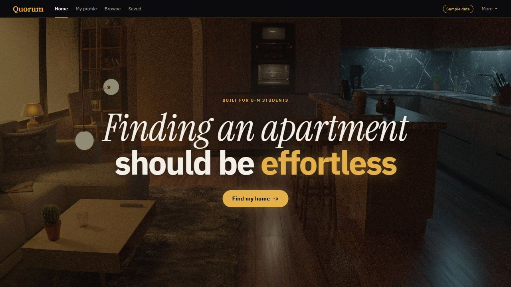

# Quorum

**Pick a home for the week you will actually live: real bus timetables, your classes, your budget, your late nights.**
Built for Hack the Lease (University of Michigan), Nov 19 to 20, 2026.



## The 5-minute demo

Full click-by-click script with every number: [`docs/DEMO.md`](docs/DEMO.md).

1. **Home**: "10 minutes from campus": 11 min to North at 2 PM, 39 min to Central at 11:30 PM, same listing.
2. **My profile**: drop a (fictional) resume. Classes, job and late nights are read in the browser; contact info is dropped.
3. **Browse**: every home labeled for that week.
4. **Saved**: the best of your saved homes, why, and how sure (best in 57% of possible weeks).
5. **Change one thing**: add a budget and "no late walks"; the answer moves to 82%.
6. **Roommates**: fictional students who like the same home, ranked by compatibility; then the fair rent split.
7. **Book a tour -> Send**: a time between classes (no tours over Thanksgiving break), a drafted email, Send.
8. **More > Next semester** and **More > Pitch** (evidence) to close.

## Run it

```
git clone https://github.com/thesanatt/hack-the-lease.git
cd hack-the-lease
node web/dist/serve.mjs        # then open http://localhost:4173
```

No install, no keys, works offline (Node 18+). Live, older build: https://quorum-a2.vercel.app (the `main` branch).
Optional: put `RESEND_API_KEY` in a repo-root `.env` to turn on **Send**; without it there is no Send button and
nothing is sent. Optional: Ollama for Robin's local assistant (see below); without it the app works as is.

## Feature -> code -> tests

| Feature | Where it lives | Tests |
|---|---|---|
| Transit router (Connection Scan on TheRide + U-M GTFS, walking on OSM streets) | `engine/transit.js`, `engine/graph.js`, `engine/week.js` | `test/transit.test.mjs`, `test/week.test.mjs` |
| Ranking across possible weeks (expected regret, "best in N% of weeks") | `engine/decide.js`, `web/src/student/rank.js` | `test/decide.test.mjs` |
| Preference learning ("which week would you rather live?") | `engine/prefs.js` | `test/prefs.test.mjs` |
| Fair rent split (envy-free, under private caps) | `engine/fair.js`, `web/src/views/GroupView.jsx` | `test/fair.test.mjs`, `web/src/views/group/views.test.mjs` |
| Next semester (price of not knowing, EVPI) | `engine/catalog.js`, `web/src/views/next/` | `test/catalog.test.mjs`, `web/src/views/next/compute.test.mjs` |
| Profile reader (resume, schedule, text, .ics; drops emails and phones) | `engine/profile.js`, `engine/ics.js`, `engine/grid.js` | `test/profile.test.mjs`, `test/ics.test.mjs`, `test/grid.test.mjs` |
| Tours (open slots on the real buses, Thanksgiving break skipped, .ics) | `engine/tours.js`, `web/src/student/tours.js`, `TourPanel.jsx` | `test/tours.test.mjs`, `web/src/student/tours.test.mjs` |
| Places (campus buildings and aliases) | `web/public/data/places.json`, `engine/profile.js` | `test/profile.test.mjs` |
| Roommates (sharing, compatibility matcher, consent) | `web/src/views/RoommateView.jsx`, `web/src/student/share.js`, `Interested.jsx`, `Consent.jsx` | none yet (UI); `web/src/student/listing.test.mjs` covers its listing reader |
| Send (tour email through Resend, off without a key) | `web/api.mjs`, `api/`, `web/src/student/send.js` | `test/send.test.mjs`, `web/src/student/tours.test.mjs` |
| Home page (numbers computed live, not typed) | `web/src/views/HomeView.jsx` | covered by the demo walk in `docs/DEMO.md` |

Run them: `npm test` (144 engine tests) and `cd web && npm test` (53 web tests).

## Data: what is real, what is made up

- **Real**: TheRide and U-M bus timetables (GTFS, Nov 2026), OpenStreetMap streets, campus places, sunset times.
- **SYNTHETIC**: all homes, rooms, rents and listing details. **FICTIONAL**: every person, including the sample
  resume (Alex Rivera), the group, and every roommate match. The class catalog is a sample (real course numbers,
  made-up sections). Sources and attributions are at the end of this file and in `docs/DATA.md`.

## What it does not do (limitations)

- No scraping and no real listings: students paste posts they can already see.
- The ranking and every number use no AI. The optional local assistant (Ollama) only proposes profile edits
  and re-orders matches; with it off, everything works the same.
- One modeled week of December timetables stands in for the whole lease. Bus delays are not modeled.
- Send uses Resend's test sender: it can only email the account owner until a domain is verified.
- Roommate profiles stay in this browser; there is no server or account system.

## More detail

Quorum helps University of Michigan students choose where to live from the week they will actually live.
Built for Hack the Lease, Nov 19 to 20, 2026.

- **Home, My profile, Browse, Saved, Roommates** (the top bar; Next semester, How we know and Pitch are under More): a student drops a resume or writes a few lines;
  `engine/profile.js` reads their week, limits, budget and values in the browser; Browse labels every home's fit
  and Saved ranks the hearted homes for that week, one sentence and two numbers per home.
- **Me** (now at `#me`, off the top bar): one student's week (classes, lab, job, gym) runs through every candidate home on the real TheRide and
  U-M bus timetables. A few "which week would you rather live?" picks learn what the student's time, dark walks
  and room features are worth. Homes are ranked by expected regret across the fall weeks the student might have.
- **Group**: five friends renting one house. Quorum picks the house, assigns rooms and splits the rent so nobody
  would rather swap, under each member's private cap. An envy matrix proves it.
- **Operator**: for a housing company with irregular houses, a fair rent per room over a synthetic population of
  students, and the dollar effect of a renovation.
- **Evidence**: how each model was checked, with the data sources.

All homes, rooms and rents are SYNTHETIC. All people are FICTIONAL personas. The bus timetables, streets and
places are real. Everything runs offline in the browser. The only network calls are optional: Send (with a
Resend key) and the local assistant (Ollama on this laptop).

## Run it on a clean laptop, no internet

The built app is in the repo (`web/dist`), so you need only Node 18 or newer, or Python 3.

```
git clone https://github.com/thesanatt/hack-the-lease.git
cd hack-the-lease
node web/dist/serve.mjs
```

Open http://localhost:4173. Wait for the footer to say "Loaded in ... ms".

No Node? Use Python instead:

```
cd web/dist
python -m http.server 4173
```

Then open http://localhost:4173. If port 4173 is busy: `node web/dist/serve.mjs web/dist 4174` and open
http://localhost:4174.

Clone over Wi-Fi beforehand; after that nothing needs the network.

The demo script is `docs/DEMO.md`. The judge Q&A cheat sheet is `docs/QA.md`.

## Optional: the local AI box (Tell Quorum)

On My profile, **Tell Quorum** takes changes in your own words ("club meeting Thursday 2 to 3 at the Union",
"drop MATH 216", "book a tour of Broadway Monday at 2"). It uses a language model running in Ollama on this
laptop; nothing leaves the laptop. Without Ollama the box falls back to the rule-based reader.

1. Install Ollama from ollama.com and start it.
2. `ollama pull llama3.2:3b` (about 2 GB, once, needs internet).
3. Run the app from this laptop (`node web/dist/serve.mjs`, open http://localhost:4173). The box shows
   "Local AI: llama3.2:3b" when it is connected.

If the box says "Local AI off" while Ollama runs, allow the app's address and restart Ollama: on Windows
`setx OLLAMA_ORIGINS "*"`, on macOS `launchctl setenv OLLAMA_ORIGINS "*"`. The model only proposes changes; the
app checks every day, time, building, calendar row and tour slot before applying it, and each answer has Undo.

**Stress test the local AI** (Ollama running): `npm run stress:ai` (or `node scripts/assistant_stress.mjs llama3.2:1b`).
It sends 30 realistic student requests (wishes, events, edits, tours, nonsense) through the real model with the
app's own instructions and checks, and prints what it understood, what the app skipped, and a score.

How it is split: the model reads free text (Tell Quorum, resumes, notes) into calendar edits and wishes; each wish
is a test on a listing field (`walk_min_to:<place>`, `laundry_free`, `lease_months`...; `web/src/student/listing.js`),
checked against the data on every Browse card. Calendar files and schedule screenshots stay with the exact readers.
The built-in sample student is always read by the rules, so the demo numbers do not move.

## Check every demo number

```
node scripts/demo_numbers.mjs
```

It loads the engine in Node and prints every number the demo quotes (Jordan's ranking, the value of knowing the
schedule, the break-even, the sensitivity moves, the group split, Priya's cap, the operator house) plus the
validation results, in about 3 seconds. It uses the same seeds as the app, so the numbers match the screen.

## Rebuild the app

Needs internet once for `npm install`.

```
cd web
npm install
npm run build        # writes web/dist, copies serve.mjs into it
node dist/serve.mjs
```

For development with hot reload: `cd web && npm run dev`.

## Run the tests

```
npm test                 # from the repo root: engine tests in test/ (64 pass)
cd web && npm test       # view logic tests (15 pass)
node scripts/check_data.mjs   # data schema, labels, every persona week from every home, group caps
node scripts/smoke.mjs        # four real trips with their legs, and scan timings
```

All of these run in Node 22 with no network.

## Where things are

| Path | What |
|---|---|
| `engine/` | The engine, plain JavaScript modules with no dependencies. `engine/CONTRACTS.md` lists every function. |
| `engine/config.js` | Every constant, with its source. The app's Assumptions drawer edits these live. |
| `web/src/` | The React and MapLibre app. One view per file in `web/src/views/`. |
| `web/public/data/` | Timetables, streets, places, the SYNTHETIC homes, the FICTIONAL personas, the operator data. |
| `web/public/data/evidence/` | Validation results the Evidence view reads: `router.json` (independent reference router), `r5.json` (r5py comparison), `lp.json` (fair-division checks), `recovery.json` (preference learning), `router_labels.json` |
| `docs/SYSTEM_DESIGN.md` | Design of record. Section 10 is the final word; section 8 lists judge attacks; section 9 has references. |
| `docs/DATA.md` | Every data file: source, date, license, and exactly what is synthetic. |
| `docs/VALIDATION.md` | How the router was checked and how to reproduce it. |
| `pipeline/` | Python scripts that built the data files and ran the router checks. |
| `scripts/` | Node scripts: data checks, LP checks, preference recovery, operator data, demo numbers. |

Reproducing the router checks (`python pipeline/validate_router.py`, `python pipeline/r5_validate.py`) needs the
raw GTFS and OSM downloads in `data/raw/`, which are not in the repo, and Java 21 for r5py. See
`docs/VALIDATION.md`.

## Data and attributions

- Transit scheduling, geographic, and real-time data provided by permission of AAATA/TheRide. TheRide GTFS feed
  version S1000304, service Nov 15 2026 to Jan 23 2027, downloaded Nov 19 2026.
- U-M bus schedules: University of Michigan Logistics, Transportation and Parking. U-M Transit GTFS feed version
  S1000100, service Aug 23 2026 to Jan 2 2027, downloaded Nov 19 2026.
- Map data (c) OpenStreetMap contributors, ODbL 1.0. Streets through osmnx, places from the Geofabrik Michigan
  extract, both Nov 19 2026.
- Modeled week: Mon Nov 30 to Sun Dec 6 2026. The December timetable stands in for the whole lease.
- Homes, rooms and rents: SYNTHETIC, made up for the demo at real residential street locations. Not listings,
  not market estimates.
- Personas and the operator population: FICTIONAL and SYNTHETIC.
- Methods are cited in `docs/SYSTEM_DESIGN.md` section 9 and in the Evidence view.

Fonts: IBM Plex Sans, IBM Plex Mono and Source Serif 4, bundled through @fontsource; Instrument Serif (OFL),
self-hosted in `web/public/fonts`. Home photo: Yusuf P on Pexels (Pexels License). Libraries: React 18,
MapLibre GL JS 4, Vite 5.
